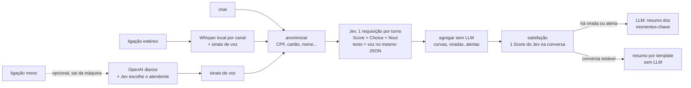

# Conversa Lens

Análise de conversas de atendimento em português do Brasil, em chat ou ligação gravada. O
foco não é dizer se uma frase é positiva ou negativa, e sim entender a **dinâmica** da
conversa:

- **Trajetória:** o cliente entrou calmo e saiu irritado? Em que turno virou?
- **Por pessoa:** a curva do cliente e, separada, a do tom do atendente.
- **Pontos de virada:** qual fala do atendente veio logo antes da piora (ou da melhora)?
- **Ação:** há risco de cancelamento? É preciso escalar? Que nota o cliente daria?
- **Voz:** na ligação, o cliente falou mais alto, mais rápido, interrompeu?

**Status:** chat e ligação funcionando de ponta a ponta, com modo em lote. Os números de
qualidade ainda são de pilotos pequenos (ver [Resultados](#resultados-até-agora)).

## A ideia central: decisões baratas por turno, LLM só no que importa



Cada turno vira **uma** requisição ao [Jev](https://docs.langchain.com/oss/python/integrations/providers/typesafe)
(TypeSafe), com todas as perguntas daquele falante:

| Falante | Pergunta | Tipo |
|---|---|---|
| cliente | sentimento (1–5) | `Score` |
| cliente | emoção: frustração, raiva, confusão, ansiedade, alívio, satisfação, neutro | `Choice` |
| cliente | há sarcasmo? · fala em cancelar? · pede escalada? | `Noul` |
| atendente | tom (1 hostil – 5 empático) | `Score` |
| atendente | postura: empático, resolutivo, burocrático, defensivo, neutro | `Choice` |
| atendente | oferece solução concreta? | `Noul` |

O estado enviado é um JSON com o turno atual e os quatro anteriores como contexto. Numa
ligação, o turno atual leva também `voz` (ver [Ligações](#ligações-áudio)). As perguntas
estão em [`questions.py`](src/conversa_lens/questions.py).

A agregação ([`dynamics.py`](src/conversa_lens/dynamics.py)) é código comum e testado: curvas
por pessoa, ponto de virada quando o sentimento do cliente muda 1 ponto ou mais entre dois
turnos dele, e alertas quando uma probabilidade passa de 0,7. O LLM recebe **só os turnos
desses momentos** e os sinais já calculados, nunca a conversa inteira
([`summarize.py`](src/conversa_lens/summarize.py)). Se nada aconteceu, ele nem é chamado.

**Sentimento, emoção e intenção ficam separados.** Um cliente educado pode estar decidido a
cancelar: a amostra [`03`](samples/03_educado_decidido_a_cancelar.txt) existe para isso.

**Ponto de virada não é causa.** A fala do atendente apontada veio *antes* da mudança. A
interface diz isso ao lado do gráfico e da análise, e o prompt do LLM proíbe afirmar causa.

## Rodar

```bash
python3 -m venv .venv
.venv/bin/python -m pip install -e ".[app,audio,openai]"
.venv/bin/python -m streamlit run app.py
```

Três abas: **Conversa** (chat colado), **Ligação** (gravação) e **Lote** (várias conversas,
tabela de alertas, CSV).

Sem chaves, tudo roda em **modo offline**: uma heurística de palavras-chave no lugar do Jev e
um resumo por template no lugar do LLM. Serve para ver o fluxo; **os números do modo offline
não dizem nada sobre o Jev**, e o app avisa na tela. Para os serviços reais, copie
`.env.example` para `.env`.

Pela linha de comando:

```bash
python -m conversa_lens analisar samples/04_sarcasmo.txt
python -m conversa_lens ligacao samples/audio/ligacao_irritada.flac          # estéreo, local
python -m conversa_lens ligacao gravacao_mono.mp3 --mono-openai              # mono, OpenAI
python -m conversa_lens ligacao samples/audio/ligacao_irritada.flac --sem-voz  # comparação
python -m conversa_lens lote samples/ conversas.jsonl --saida relatorio      # CSV + JSONL
python -m conversa_lens csat avaliar relatorio.jsonl                          # com notas reais
python -m conversa_lens csat treinar relatorio.jsonl --saida csat_model.json
```

Entradas: chat com uma fala por linha (`Cliente:` / `Atendente:`, aceita `Agente:`,
`Operador:` e horário entre colchetes), ou `.jsonl` com uma conversa por linha
`{"id", "messages": [{"role": "customer"|"agent", "content"}], "nota"}` (o formato dos
datasets; `nota` é opcional).

## Ligações (áudio)

[`audio/`](src/conversa_lens/audio/) transforma a gravação em turnos e mede a voz.

**Quem falou o quê.**

- **Estéreo** (um canal por pessoa, o padrão de muitas centrais): cada canal é transcrito com
  [faster-whisper](https://github.com/SYSTRAN/faster-whisper) na própria máquina. O canal diz
  quem falou, então não existe erro de diarização, e **o áudio não sai da máquina**. O
  Whisper às vezes junta duas falas separadas por um silêncio longo; por isso as falas são
  cortadas pelas pausas entre palavras (timestamps por palavra).
- **Mono:** opcional, com `gpt-4o-transcribe-diarize` da OpenAI, que devolve "falante A/B".
  Uma pergunta `Choice` ao Jev, sobre as primeiras falas de cada um (já anonimizadas),
  decide quem é o atendente. **Aqui o áudio original vai para a OpenAI antes de qualquer
  anonimização.** A alternativa local seria o pyannote (exige ffmpeg, torch e token do
  Hugging Face); fica como extensão.

**Sinais de voz por turno** ([`acoustics.py`](src/conversa_lens/audio/acoustics.py)), simples
e conferíveis, sem modelo de emoção na voz:

| Sinal | Como é medido |
|---|---|
| volume | RMS em dB, só nos trechos com voz |
| tom | frequência fundamental mediana (YIN) |
| velocidade | palavras por segundo (só com 6 palavras ou mais; abaixo disso a pausa domina a conta) |
| interrupção | segundos em que começou a falar antes de o outro terminar |
| silêncio antes | tempo até responder |

Volume, tom e velocidade são **relativos ao começo da ligação daquele falante** (mediana do
primeiro terço das falas dele). Assim, quem fala alto sempre não parece irritado, e quem passa
a ligação irritado não "vira normal". Os números vão para o Jev junto com uma leitura em
palavras gerada por limiares fixos, por exemplo *"falou bem mais alto que no começo da
ligação (+6 dB); interrompeu o outro"*:

```json
{"falante": "cliente", "texto": "Não! É só isso mesmo!",
 "voz": {"velocidade_vs_inicio_pct": 32, "volume_vs_inicio_db": 6.3,
         "tom_vs_inicio_semitons": 2.1, "silencio_antes_s": 0.0,
         "interrompeu_o_outro_s": 0.5, "leitura": "falou bem mais alto ...; interrompeu o outro"}}
```

## Satisfação (CSAT)

Duas camadas ([`csat.py`](src/conversa_lens/csat.py)), para não chamar de previsão o que
ainda não foi validado:

1. **Estimativa, sem treino:** uma pergunta `Score` ao Jev sobre a conversa inteira ("que
   nota este cliente daria?"). Custa uma requisição por conversa.
2. **Modelo calibrado, com notas reais:** quando houver conversas com a nota da pesquisa,
   `csat treinar` ajusta uma regressão (ridge) sobre a estimativa do Jev e os sinais da
   conversa (como terminou, a pior fase, viradas, alertas, tom do atendente). `csat avaliar`
   compara com baselines por validação cruzada. O app usa o modelo se `csat_model.json`
   existir.

## Robustez

- **Retry por turno:** erros transitórios do TypeSafe (limite de taxa, 5xx, timeout, rede)
  são repetidos até 4 vezes com espera exponencial, respeitando o `Retry-After`. Erros
  permanentes (chave inválida, requisição malformada) param na hora, porque repetir não
  resolve.
- **Análise parcial:** um turno que continua falhando vira uma lacuna. A curva, as viradas e
  o resumo seguem sem ele, e a interface e o prompt avisam quais turnos ficaram sem leitura.
  Nunca vira uma leitura "neutra" inventada.
- **LLM fora do ar:** o resumo cai para o template, com aviso. Só falhas do provedor ativam
  isso; um bug no código continua aparecendo.
- **Satisfação fora do ar:** a análise segue com o valor offline.
- **Lote:** uma conversa ilegível ou com falha vira uma linha com `erro`; o lote continua.

## LGPD e privacidade

- **A anonimização roda antes do Jev e do LLM.** CPF, CNPJ, cartão (com dígito verificador),
  e-mail, telefone, CEP e endereço com número viram marcadores. Um nome dito numa
  apresentação ("meu nome é Ana") é trocado na conversa inteira, e o app aceita uma lista de
  nomes conhecidos (do CRM, por exemplo).
- **O limite é conhecido:** a anonimização usa padrões. Um nome solto no meio da frase passa.
  Para produção, combine com um reconhecedor de entidades em português (por exemplo,
  Microsoft Presidio) e revise uma amostra à mão.
- **Áudio:** no estéreo, a transcrição é local e só o texto anonimizado e os números de voz
  saem da máquina. No mono pela OpenAI, o áudio bruto sai.
- O texto anonimizado vai para o TypeSafe e para o provedor do LLM.
- As amostras em `samples/` são fictícias; as ligações são voz sintética do macOS.
- A telemetria do Streamlit está desligada em `.streamlit/config.toml`.

## Resultados até agora

Tudo abaixo é piloto: amostras pequenas, uma execução cada.

**Satisfação, 207 conversas reais do JDDC traduzidas para português** (atendimento do
JD.com, nota de anotadores; piloto em chinês, português e inglês e detalhes em
[`benchmarks/uss/`](benchmarks/uss/README.md)):

| método | MAE | Spearman | insatisfeitas achadas (de 52) | alarmes falsos |
|---|---:|---:|---:|---:|
| sentimento final do cliente | 0,71 | 0,62 | 32 | 13 |
| **estimativa do Jev, sem treino** | 0,71 | **0,74** | **38** | 17 |
| modelo calibrado (CV 5 dobras) | **0,60** | 0,74 | 23 | 2 |

- A tradução preserva o sinal: a estimativa do Jev para a mesma conversa em chinês e em
  português concorda com Spearman 0,96 (34 conversas).
- Sem treino, o Jev ordena bem e acha 73% das insatisfeitas, mas comprime a escala.
- Com 200 conversas, o modelo calibrado acerta melhor o número e quase não dá alarme falso,
  mas acha menos insatisfeitas. Para triagem, a estimativa pura; para o número, o calibrado.

**Voz, duas ligações sintéticas com o mesmo texto** ([`samples/audio/`](samples/audio/)):

| fala do cliente | só texto | com voz, ligação calma | com voz, ligação irritada |
|---|---:|---:|---:|
| "Ótimo! Muito obrigado, viu?" | 4,7 | 4,4 | 4,1 |
| "Não! É só isso mesmo!" | 3,6 | 3,6 | 2,9 |
| sarcasmo em "Ótimo!..." | 0,20 | 0,19 | 0,27 |

- Na **primeira versão**, só números iam para o Jev, e a leitura quase não mudava entre calma
  e irritada. Com a leitura em palavras ao lado dos números, a voz passou a pesar no
  sentimento.
- **O sarcasmo quase não se mexeu.** Pelo menos nesta forma, a voz não convenceu o Jev de que
  "ótimo" era irônico.
- São duas ligações com voz sintética: isso mostra que o caminho funciona, não que a voz
  melhora a detecção.

**Voz e sarcasmo, 690 falas reais do MUStARD** (séries em inglês, metade sarcásticas;
detalhes em [`benchmarks/mustard/`](benchmarks/mustard/README.md)):

| condição | AUC | macro-F1 |
|---|---:|---:|
| só texto | 0,814 | 0,697 |
| texto + voz | 0,809 | 0,698 |
| só os números de voz (sem Jev) | 0,525 | – |

**A voz não ajudou** (ΔAUC −0,005, IC95% [−0,015; +0,005]). Os sinais simples que medimos
quase não separam sarcasmo de fala sincera sozinhos, então não havia o que o Jev aproveitar.
O Jev, só com o texto e o contexto, já detecta sarcasmo bem, sem treino.

## Datasets

Não existe conjunto público em PT-BR com conversa de atendimento e CSAT real.

| Dataset | O que tem | Uso aqui |
|---|---|---|
| [USS / JDDC](https://github.com/sunnweiwei/user-satisfaction-simulation) | 3.300 atendimentos reais (chinês) com nota 1–5 por turno e por conversa; sem licença declarada | piloto de satisfação (baixado na hora, não redistribuído) |
| [USS / MultiWOZ, SGD, ReDial, CCPE](https://github.com/sunnweiwei/user-satisfaction-simulation) | inglês, assistentes de tarefa, quase tudo nota 3 | pouco útil para CSAT |
| [brazilian-customer-service-conversations](https://huggingface.co/datasets/RichardSakaguchiMS/brazilian-customer-service-conversations) | ~1.000 conversas PT-BR **sintéticas**, com intenção e sentimento da conversa; Apache-2.0 | testar o lote em volume; checagem grosseira de sentimento |
| [Olist](https://www.kaggle.com/datasets/olistbr/brazilian-ecommerce) e [B2W-Reviews01](https://huggingface.co/datasets/ruanchaves/b2w-reviews01) | avaliações reais PT-BR com nota 1–5 | calibrar o `Score` de sentimento em PT-BR (frases, não conversas) |
| [MUStARD](https://github.com/soujanyaporia/MUStARD) | 690 falas de séries em inglês, sarcasmo com áudio e vídeo; MIT | teste de voz × sarcasmo (feito) |
| [MELD](https://github.com/declare-lab/MELD) | 13 mil falas de Friends com sentimento, emoção e áudio; GPL-3.0 | testar a curva de sentimento com voz |
| [emoUERJ](https://zenodo.org/records/5427549), VERBO, CORAA SER | fala PT-BR com emoção (atuada ou espontânea) | validar os sinais de voz em PT-BR |
| [portuguese-call-center-speech-pt](https://huggingface.co/datasets/MaratDV/portuguese-call-center-speech-pt) | 1.605 h de call center em português, estéreo; licença comercial, só uma amostra aberta | teste interno de transcrição; não redistribuir |
| [Customer Support on Twitter](https://www.kaggle.com/datasets/thoughtvector/customer-support-on-twitter) | 3 milhões de tweets de atendimento, inglês, sem rótulo | volume para o lote |

## Cuidados e limitações

- **Erro em cascata.** Uma fala transcrita errado ou atribuída à pessoa errada contamina a
  curva. No estéreo a atribuição é pelo canal; a qualidade da transcrição fica registrada por
  turno (`asr_logprob`), mas ainda não é usada.
- **Os limiares não foram calibrados**: 1 ponto de variação, 0,7 de probabilidade e os
  limiares da leitura de voz são pontos de partida.
- **Sarcasmo e regionalismo** são os casos difíceis do português brasileiro.
- `langchain-typesafe` é alpha (0.0.1a3).

## Referência: o que a pesquisa já diz

[Emo-Jev](https://arxiv.org/abs/2610.08829) (Zhang e Yu) avaliou o Jev em oito conjuntos de
sentimento, emoção, sarcasmo e humor, todos em inglês. O **Jev padrão** teve 62,93% de
macro-F1 médio, contra 67,28% do melhor LLM, com custo de inferência 96,41% menor e mediana
de latência de 250 ms. **As duas variantes Emo-Jev** ficaram em 62,00% e 61,61%: um pouco
abaixo do Jev padrão, e mais caras.

## Roadmap

1. ~~MVP: chat, Jev por turno, curvas, viradas, alertas, resumo com LLM.~~
2. ~~Áudio: transcrição, quem falou o quê, sinais de voz no estado do Jev.~~ Falta: pyannote
   local para mono; usar a confiança da transcrição.
3. **Benchmark PT-BR:** conversas e ligações rotuladas comparando texto contra texto + voz e
   Jev contra LLM por turno, em acerto, custo e latência. Reportar os erros, não só os
   acertos.

O alerta de escalada pode virar uma ferramenta com limiar de confiança no
[`jev-lanes`](https://github.com/EricMariano/jev-lanes) (`GatedTool`).

## Desenvolvimento

```bash
.venv/bin/python -m pip install pytest ruff mypy
.venv/bin/python -m ruff check . && .venv/bin/python -m ruff format --check .
.venv/bin/python -m mypy
.venv/bin/python -m pytest
```

Os testes são offline: um cliente TypeSafe falso verifica o formato das requisições, o retry
e as falhas parciais; o áudio é testado com sinais sintéticos. Nenhum teste chama serviço
externo nem baixa modelo.

```
src/conversa_lens/
  parsing.py      chat em texto ou mensagens → turnos
  anonymize.py    dados pessoais → marcadores
  questions.py    perguntas ao Jev por falante
  classify.py     Jev (com retry por turno) e a heurística offline
  dynamics.py     curvas, pontos de virada, alertas (sem LLM)
  csat.py         satisfação: estimativa do Jev, modelo calibrado, avaliação
  summarize.py    resumo com LLM só dos momentos-chave, ou por template
  graph.py        o fluxo em LangGraph
  batch.py        modo em lote, relatório CSV/JSONL
  providers.py    escolhe Jev/LLM ou modo offline conforme as chaves
  audio/          transcrição, papéis, sinais de voz, pipeline da ligação
app.py            interface Streamlit (Conversa, Ligação, Lote)
samples/          quatro chats e duas ligações fictícias
benchmarks/uss/   piloto de satisfação no JDDC
```
